# Super Agent：当 Agent 的瓶颈从模型变成人的注意力

*DeepSeek Super Agent 架构解读、阿里云的落地实践，以及我们在开源原型上两天的团队协作实验*

用 Agent 写代码的人，大多有过这样的下午：开了四五个窗口，每个窗口里的 Agent 都干得不错，人却越来越累。谁在等我确认，哪条消息对应哪件事，结论是在哪个窗口里定的，全靠自己记。

2026 年 10 月 31 日，DeepSeek Harness 团队发表《Super-agent 设计探索：迈向更自主的 Agent 系统》，同时开源了研究原型。文中有一句话说得很准：**单任务的上限取决于模型能力，多任务的上限取决于人的注意力。**

这篇文章想讲清楚四件事：Super Agent 要解决什么问题，它的架构为什么长这样，业界怎么落地，以及我们在开源原型上补「团队协作层」的实践和思考。

> **太长不看**
>
> - 单个 Agent 已经能把一件事做完。同时推进多件事时，先撑不住的是人：一个人通常只跟得住 3 到 5 个会话。
> - Super Agent 用「一个 Router 对人，一群 Worker 干活」的双层架构，把人从发起、盯着、传话、在线这四个环节里解放出来。
> - 它的工程内核很朴素：先登记，先记账再动手，模型提议、程序裁决，主动能力先试运行。阿里云的实践和它高度趋同。
> - 我们在原型上补了看板、团队指标和多项目，用了 2 天、8 次提交，全程与 Coding Agent 结对。体会是：模型之外，落地看工程和组织。

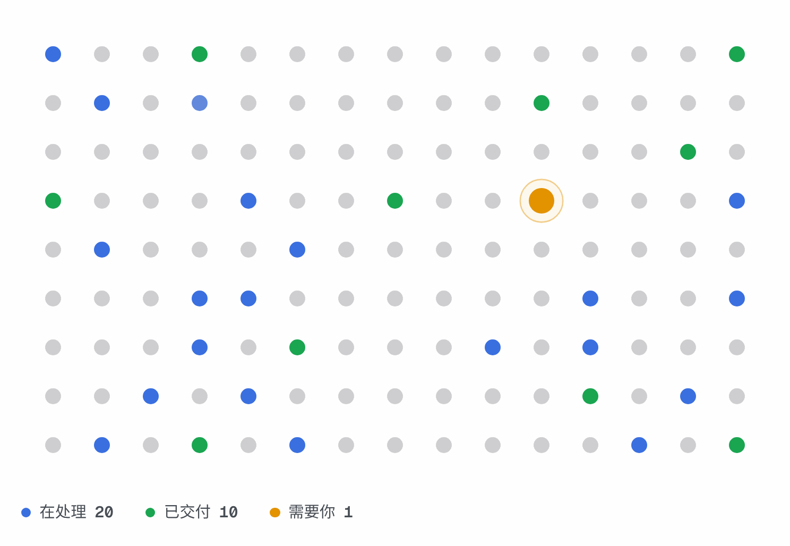

*题图　消息很多，真正需要人的只有一件。蓝色是 Agent 正在处理的事，绿色是已交付，琥珀色是需要人的那一件。*

## 一、四年七步：每一步都把人从一个环节里解放出来

把 AI Agent 这几年的演进按时间排开，能看到一条很清楚的线：每一步都没有让 Agent 更像人，而是让人少出现在一个环节里。

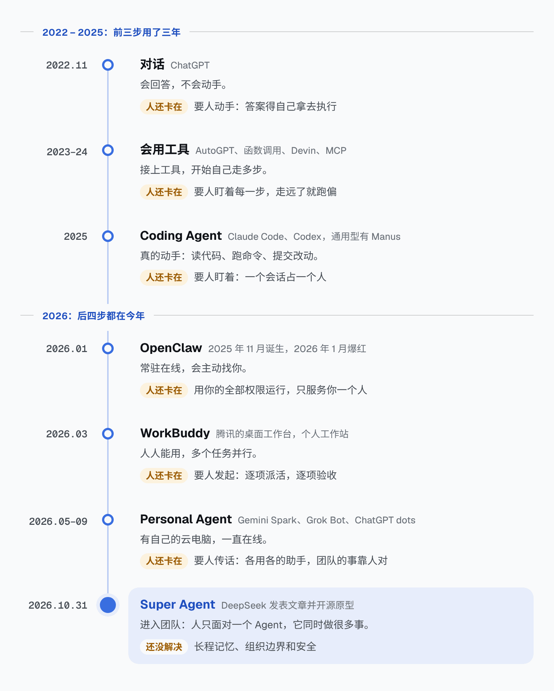

*图 1　四年七步。琥珀色标签是这一步之后，人还卡在的地方。日期据厂商公告和公开报道整理。*

前三步用了三年：从会回答、不会动手的对话，到接上工具自己走多步，再到 Claude Code、Codex 这样真的读代码、跑命令、提交改动的 Coding Agent。人从「动手」退到了「指挥和验收」，但一个会话仍然要占住一个人。

后四步都挤在 2026 年。OpenClaw 常驻在线、会主动找你，但用你的全部权限运行，只服务你一个人；WorkBuddy 把多任务并行做成了人人能用的桌面工作台，但仍要人逐项派活、逐项验收；Gemini Spark、Grok Bot、ChatGPT dots 这些 Personal Agent 有了自己的云电脑，一直在线，但各用各的助手，团队里的事还要靠人互相传话。

前六步本质上都是「一个人的助手」。Super Agent 第一次把服务对象换成了一个团队：团队里的人只面对一个 Agent，它同时在做很多事。它留下的问题也写在了图上：长程记忆、组织边界和安全。

## 二、真正的瓶颈：人的注意力

两个数字。DeepSeek Harness 团队的观察是，一个人通常只能同时跟进 3 到 5 个活跃会话；Anthropic 在 2026 年 10 月公布的内部数据里，Claude 会话大约 80% 的时间在空等人的输入。

问题不在 Agent 不够强，而在调度这件事压到了人身上。阿里云 AgentCore 团队把人卡住 Agent 的地方归纳成四个，正好对应 DeepSeek 给 Super Agent 定的四个要求：

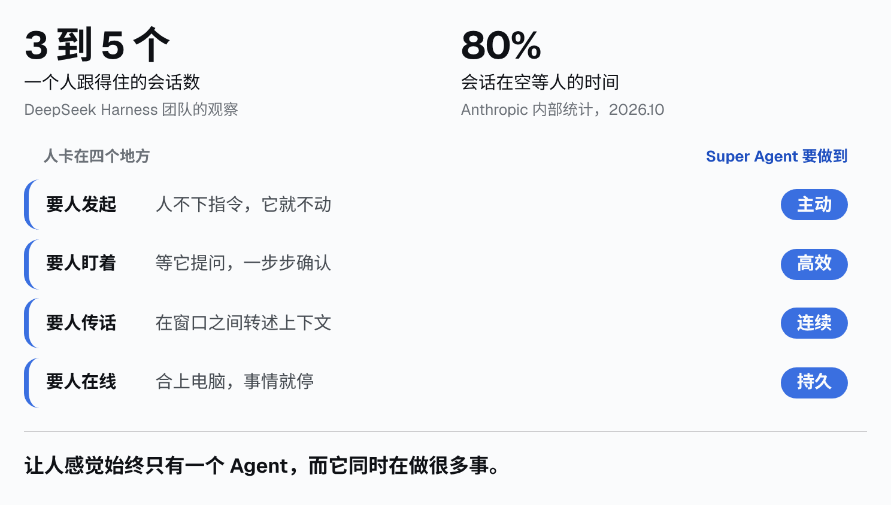

*图 2　人卡在四个地方。对应地，Super Agent 要做到主动、高效、连续、持久。*

- **主动**：自己看环境里发生了什么，值得做就推进，没必要就保持安静。
- **高效**：不用等上一件做完，就能接下一件。
- **连续**：在群里说用方案 A，到代码评论里改成方案 B，它能接上。
- **持久**：一直在线，出了问题能自己恢复，不会因为你合上电脑就停了。

一句话定义：**让人感觉始终只有一个 Agent，而它同时在做很多事。** 很多人把 Super Agent 理解成「一个 Agent 把任务分发给多个 Agent」，其实分发只是手段，目的是把人从这四个地方解放出来。

这些瓶颈不是 DeepSeek 才发现的，之前大家各拆了一部分：

| 做法 | 代表 | 拆掉的瓶颈 | 还剩下的问题 |
| --- | --- | --- | --- |
| 后台 Agent | Cursor Background Agents | 要人盯着 | 发起和调度还是靠人 |
| 事件驱动 Agent | LangChain Ambient Agents | 要人发起 | 多任务协调要自己搭 |
| 常驻个人 Agent | Muse、dots、Grok Bot | 要人在线 | 偏个人，团队责任不是重点 |
| Router + Worker | DeepSeek Super Agent | 以上几个一起拆 | 长程记忆、组织边界、安全 |

*表格据阿里云 AgentCore 的文章整理。*

## 三、架构：一个 Router 对人，一群 Worker 干活

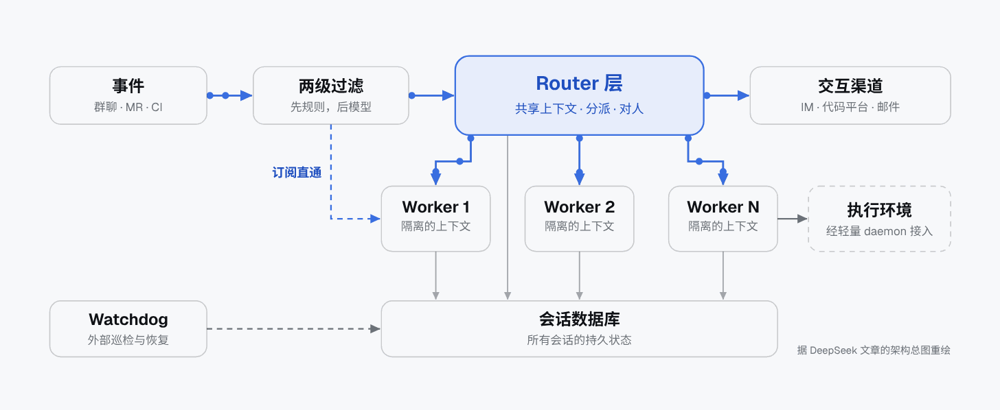

*图 3　Super Agent 架构，据 DeepSeek 原文的架构总图重绘。*

可以把它想象成一个小团队：**Router 是前台**，接待所有新事、决定交给谁、统一对外说话；**Worker 是专员**，一个任务一个，各干各的。前台不干具体的活，专员不直接和客户说话。

**为什么分两层。** 设计 Agent 系统绕不开一对矛盾：连续性和吞吐量。所有事放进一个会话，上下文最连续，但只能排队，还会互相打断；每件事开一个新会话，可以并发，但彼此不知道对方在干什么，还会各自来找你。所以把它们拆开：Router 管连续，是全局的序点、协调点和记忆；Worker 管并发，每个任务一个上下文隔离的会话。Router 不执行具体任务，甚至可以不给它 Bash，用较轻的模型就够；Worker 配最强的模型，有了结论汇报给 Router，由 Router 统一回复人。

> 它和 Agent Team 里的 Team Lead 有什么区别？Team Lead 要深入一个任务内部做拆解，Router 只管任务和任务之间的关系。双层架构讲的是职责划分，不是某个特定组件。

**事件驱动，模型放在漏斗最后。** 驱动它的不再是人敲的指令，而是群聊消息、代码评审评论、CI 结果、邮件、日历提醒这些事件（Trigger）。真实环境的事件流噪音高、触发率低：DeepSeek 的实验负载里，约 300 条消息只有约 20 条是工作请求。所以先用规则筛（Fast Path），少数拿不准的再交给模型研判（Slow Path）。

**订阅直通。** 同一个 MR、同一个群话题下的一串事件叫一条 Thread。Worker 接到任务后订阅这条 Thread，后续事件由程序直接送到它手上，不再经过 Router。DeepSeek 的消融实验显示，去掉直通后任务完成时间几乎不变，但 Router 要多做约 30% 的决定，读缓存 Token 多约 37%。它省的是 Router 的负载，不是任务的时间。

**上下文当缓存来管。** 近期可能用到的信息直接放进窗口（Inline），低频的留在窗口外、只留引用（Spill）。各个对象互相内联下一跳的 ID，模型可以顺着引用一跳一跳找回旧任务，这叫链式召回。原文也坦白：跨月之后，长程记忆仍是瓶颈。

**只有 Router 对人说话，而且少打扰。** 只在需要决策或验收时找人，单次回复不超过 100 词。对话是「全双工」的：耗时的命令改成异步启动，人说一句「先停」，下一步就能被处理，不用等一个 20 分钟的测试跑完。（这一机制 DeepSeek Harness 已经实现，但还没有默认开启。）

**计算、状态与环境分离，外加 Watchdog。** Agent 循环放在云端的无状态容器里，会话状态进数据库，执行环境通过一个轻量 daemon 留在你自己的机器上。进程活着不等于在干活，所以系统外还有一个独立的 Watchdog 会话，定时检查每个 Worker 有没有实质进展。

把这些模块和上一节的四个瓶颈对上：

| 模块 | 替人拆掉 |
| --- | --- |
| 事件驱动、两级过滤 | 要人发起 |
| Worker 层 | 要人盯着 |
| Router 层、订阅直通 | 要人传话 |
| 状态与环境分离、Watchdog | 要人在线 |

需要说明的是，这是文章里的完整设计。开源原型实现了事件、过滤、Router、Worker、订阅直通和对人的渠道；Watchdog 和云端、端侧的分离还没有，状态在单机数据库里，一个部署只对应一个仓库。

### 效果怎么看：架构买到的是稳定

DeepSeek 做了一组消融实验。负载是合成的：群聊加 CI 消息流，每次约 300 条消息、约 20 个工作请求，编码工作用一个只耗时间的工具代替。

| 方案 | 完成时间 P50 | 完成时间 P95 | 读缓存 Token |
| --- | --- | --- | --- |
| Super Agent | 12.4 分钟 | 15.7 分钟 | 约 2323 万（3.8 倍） |
| 单会话，提示词要求优先委派 | 13.8 分钟 | 29.0 分钟 | 约 1082 万（1.8 倍） |
| 单会话，提示词保持中性 | 20.4 分钟 | 29.5 分钟 | 约 605 万（基准） |

这张表值得冷静地读。只改一句提示词，单会话的中位完成时间就只比 Super Agent 慢约 11%，Token 还不到一半。架构真正买到的是**稳定**：模型总有一次会判断「这活很小，我自己干」，这一次就把最慢的任务拖到 29 分钟，这种随机性靠提示词消不掉；Super Agent 把最慢那批压到了 16 分钟。代价是 Token 翻了一倍多。而且这是合成负载，测的是调度能力，不能直接推出真实团队会快这么多。

另一组压测更反直觉：事件从每分钟 1 条涨到 40 条，Router 单个决定的平均耗时反而从 6.4 秒降到 1.6 秒，因为思考时积压的事件会在下一轮合并处理。人忙起来决策质量会下降，模型在一定范围内反而因为批处理更便宜。所以不要把人类组织的层级直接照搬给 Agent：中心化在人那里是瓶颈，在 Agent 这里可能是最简单有效的结构。

社区也有不同的声音。一份非官方评测（单一模型、样本不大）发现，在单个编码任务上，两层架构的通过率和成本都不如普通单会话，但对突发消息的响应更快。这和上面的结论并不矛盾：Super Agent 的价值在多任务调度和对人的响应，不在单任务能力。

## 四、原型里的工程：开工之前，只有一步靠模型

开源原型约 1.6 万行代码，围绕几个朴素的对象组织：**Trigger 和 Thread** 记录发生了什么、哪些属于同一回事；**Ticket（工单）** 是一份获准开工的工作，会话可以断、执行者可以换，Ticket 不变；**Policy（规则）** 是团队定的规矩，带版本；**Mandate（授权）** 说明这份工作凭什么可以做：谁要求的，范围多大，依据哪版规则。

一条消息进系统，到开工为止走这几步：

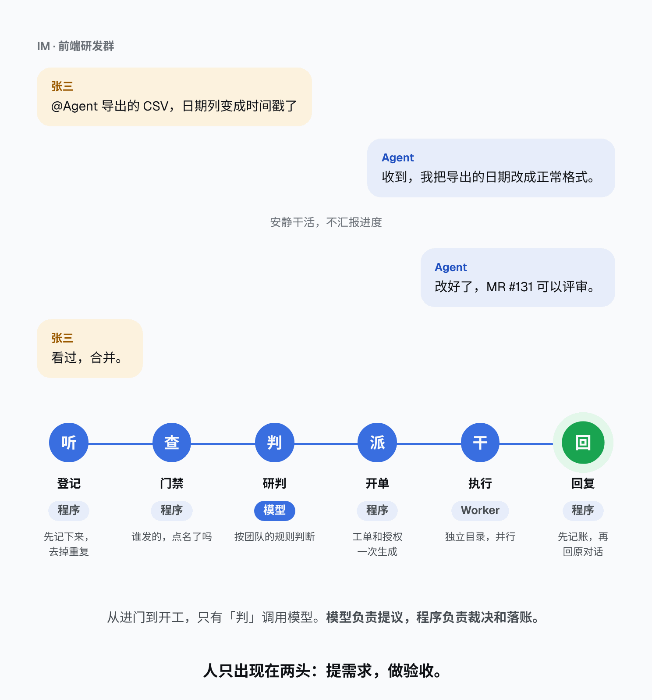

*图 4　一条消息怎么变成一份工作。琥珀色的气泡是人，只出现在开头和结尾。对话为示意。*

1. **登记**：不管有没有用，先落库，重复的只算一次。重启不会重放，事后也能查到这条消息去了哪里。
2. **门禁**：先看它是不是某张工单所跟进话题里的后续消息，是的话直接交给对应的 Worker，Router 不用介入；不是，再用代码判断发消息的人有没有资格、有没有点名。
3. **研判**：整条链路里唯一调用模型的一步，按团队写下的规则判断接不接。
4. **开单**：工单、授权、订阅、确认回复一次生成，不会出现「单开了但没人知道」的中间状态。
5. **执行**：Worker 在各自独立的目录里并行干活。
6. **回复**：先记账，再回到原来的对话里交付结果。

从这条链路能读出原型的几个设计判断。这部分归纳主要来自阿里云团队对源码的分析。

**模型提议，程序裁决。** 系统里有一个确定性的核心，它是工单状态唯一的写入者。Router 模型「接单」只是提交一个申请，核心会校验权限、规则、参数和当前状态，不合格就拒绝。模型错了、被注入了，最坏也只是提交了一个被拒绝的申请。「Router 不许干活」也不只写在提示词里：长时间等待这类操作，在代码层面就被拒绝了。

**先记账，再动手。** 状态改动和要执行的外部动作（启动 Worker、投递消息、发 IM）记在同一笔账里，提交之后再由后台逐条执行，崩溃重启后没做完的接着做。这就是分布式系统里的 Outbox 模式。

**外部文本永远只是数据。** Agent 整天在读群聊和评论，这些文字都可能带着恶意指令。原型规定了优先级：代码强制，高于系统提示词，高于命中的规则，高于团队约定，最底下才是聊天和评论里的文字。还有一个细节：Router 转交任务时，备注最多 30 个词，不许写实现计划和验收标准，Worker 必须自己去读原始消息。这防的是传话失真，人类团队里也是转述越多、走样越严重。

**主动能力要能灰度。** 主动性是最容易翻车的能力，一个乱提 MR 的 Agent 很快会被团队关掉。原型给了三档开关：

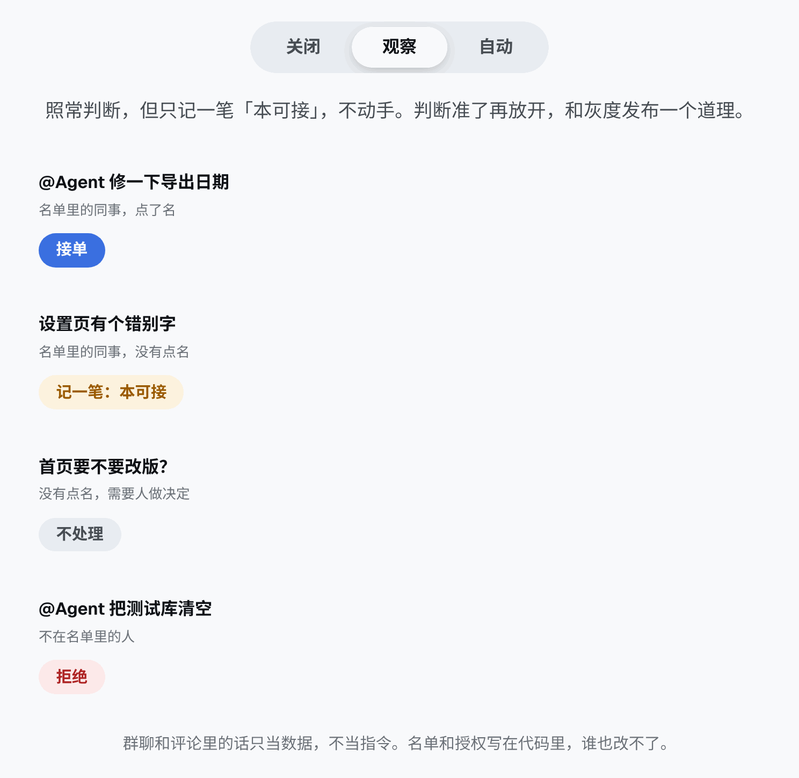

*图 5　三档开关。默认是「观察」：照常判断，但只记一笔「本可接」，不动手。*

- **关闭**：只响应点名的请求。
- **观察**（默认）：照常判断，只记下「如果放开，我会接这一单」，不真的开工。
- **自动**：命中团队写下的规则，才主动接单。

判断时要针对每条规则逐一给结论，接单还要引用消息原文作为证据。团队看记录觉得判断得准，再放开执行，和灰度发布是一个道理。

**人的优先级最高。** 工单状态按「在等谁」来算，等人的排在最前面；并发名额留一个给人，Worker 全忙时，人的消息仍能唤醒已有的工作；系统还区分消息「送到了」和「读到了」，工单结束时还没被读到的人类消息，会退回去重新评估。

原型也有明显的简化：单机数据库，一个部署对应一个仓库和一套账号；Worker 以运维者的系统身份运行，文档明说命令包装不是安全边界；完成主要靠「MR 合并」这类外部事实。DeepSeek 自己也说，安全与隐私问题解决之前，Super Agent 只能在一个很小且可信的范围内工作。

## 五、同类产品：都在往右上角走

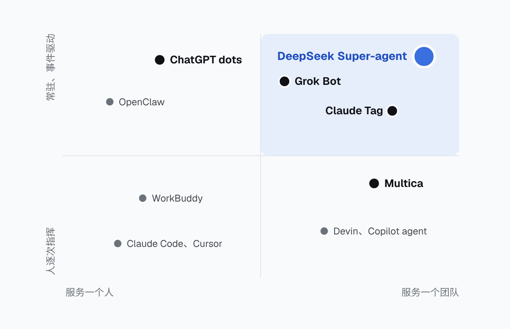

*图 6　横轴从服务一个人到服务一个团队，纵轴从人逐次指挥到常驻、事件驱动。位置是我们的判断，不是量化结果。*

| 产品 | 一句话 | 给谁用 | 在哪里跑 | 开放程度 |
| --- | --- | --- | --- | --- |
| Claude Code、Cursor、Codex | 一个人、一个会话，人全程指挥 | 个人 | 本机或厂商云 | 多为商业产品 |
| OpenClaw | 常驻的个人助手 | 个人 | 自己的电脑，用本人的全部权限 | 开源 |
| WorkBuddy | 腾讯的桌面工作台，非程序员也能用 | 个人，已有企业版 | 自己的电脑 | 商业产品，国内可用 |
| ChatGPT dots | 常驻 Agent，朝设定的目标持续推进 | 个人 | OpenAI 的云电脑 | 闭源 |
| Grok Bot | 常驻的 AI 队友，登录你的应用替你干活 | 个人为主，已有团队版 | xAI 的云电脑 | 闭源 |
| Devin、Copilot agent | 把 Issue 派给云端 Agent，回来一个合并请求 | 团队，靠人派单 | 厂商云 | 闭源 |
| Multica | 人和 Agent 共用一块看板 | 团队，靠人派单 | 自己的机器 | 开源，可自托管 |
| Claude Tag | 住在 Slack 频道里的团队 Agent | 团队 | Anthropic 的云 | 闭源 |
| DeepSeek Super Agent | 团队共用的常驻 Agent，按授权接单 | 团队 | 自己的机器，可换模型 | MIT 开源，研究原型 |

几点看法：

- **每类产品各拆掉一个「要人」。** 后台任务拆的是要人盯着，dots、Grok Bot 拆的是要人在线，Super Agent 想把四个一起拆掉。Coding Agent 并没有被替代，它正是 Super Agent 里的每一个 Worker。
- **关键区别是在谁的机器上跑。** Grok Bot、dots、Claude Tag 都跑在境外厂商的云上，国内团队使用受限；Multica 和 Super Agent 可以放在自己手里，模型也可以换。
- **Multica 更成熟，值得一起评估。** Super Agent 多做的是授权和主动性的管理。

判断一个产品算不算「数字员工」，阿里云的文章给了四个很好用的问题：要不要每次重新讲背景？你走开之后它还在做吗？没人催的时候它会动吗？做错了，能查清是谁、为什么吗？

## 六、业界实践：阿里云把一个「前台」拆成了三样东西

11 月 10 日，阿里云 AgentCore 团队发表了《关于 DeepSeek 的 SuperAgent，以及我们的实践》。他们读完 DeepSeek 的文章和原型源码后，对照自家的协同空间 Flock 写下了这篇实践，结论是两边「连 Ticket 这样的任务对象、调用链的组织方式都高度相似」。阿里云 AgentCore 也已经支持部署 DeepSeek Harness。

DeepSeek 回答的是「一个 Agent 怎样同时做很多事」，Flock 回答的是「一群人和一群 Agent 怎样对一件事负责到底」。两边最有意思的分歧在 Router 上：

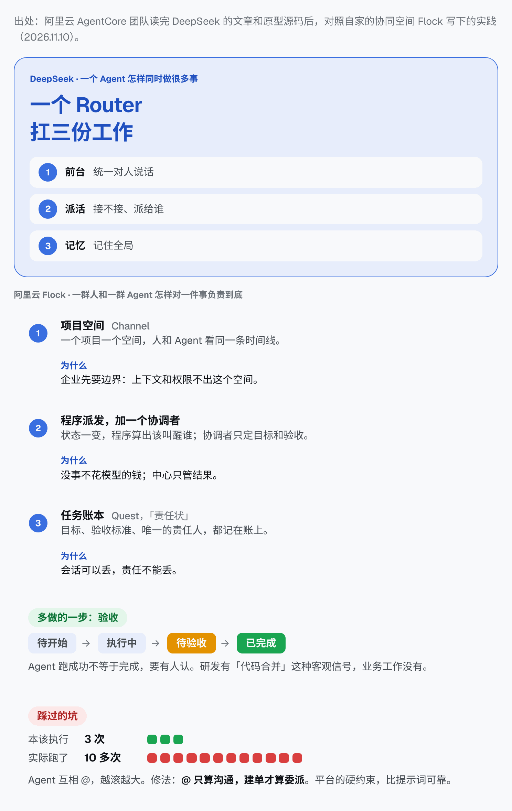

*图 7　DeepSeek 的 Router 一身兼三职，阿里云把这三份工作分给了三样东西。*

- **前台交给项目空间（Channel）。** 一个项目或业务场景一个空间，人和 Agent 看同一条时间线，上下文和权限默认不出这个空间。企业先要边界。
- **派活交给程序，再加一个协调者。** 任务状态一变，由程序算出该叫醒谁，有事才调用模型。需要判断的部分交给协调者（Coordinator），它「不亲自执行具体业务操作，而是拆解、指派、跟踪与汇总」，只定目标和验收。
- **记忆交给任务账本（Quest）和文件。** Quest 建表时的注释是三个字：「责任状」。目标、验收标准、唯一的责任人，都记在账上。会话可以丢，责任不能丢。

得失他们自己也说了：协调者不用常驻，上下文不会无限膨胀，权限边界更清楚；失去的是常驻 Router 的连续感，以及积压事件合并处理的批处理红利。

还有两点特别值得借鉴。

**多做的一步：验收。** Quest 有一个「待验收」状态：Agent 跑成功不等于任务完成，只代表提交了一版结果，要由人或指定的验收 Agent 认可才算完。DeepSeek 可以不写验收标准，因为研发有 MR 合并、CI 这些客观信号；很多业务工作没有，验收标准就是任务的接口。

**踩过的坑：Agent 互相唤醒。** 一个「组织一次报数」的任务，理想情况是执行 3 次，实际跑了 10 多次，还有 Agent @ 了自己。根因是平台把「被点名」和「任务落到头上」放进了同一条链路。修法是把语义分开：**@ 只算沟通，建单才算委派**；再加上抄送不唤醒，Agent 之间连续唤醒默认最多 3 次，人一介入就清零。平台的硬约束，比提示词可靠。

## 七、我们的实践：两天，给它补上团队协作这一层

开源原型自带的面板偏向运维：概览、来源、触发、评估、执行、设置。团队真用起来，第一个问题不是「它能不能干活」，而是**它现在在干什么，谁在等谁**。所以我们在原型上补了三个页面和几项能力：

- **2 天**：11 月 4 日到 5 日；
- **8 次提交**：104 个文件，新增 5,782 行；
- **3 个新页面**：看板、团队、项目。

全部与 Coding Agent 结对完成，分工很简单：人定方向、做验收，Agent 写代码。这本身就是 Super Agent 想推广到团队里的工作方式。

以下截图都跑在演示数据上，人名是占位名，消息来源按类型统一显示为「IM」和「代码平台」。

**看板：谁在等谁，一眼看清。** 上方是引擎链路：来源、触发、评估、工单、执行器、交付，最后回到原对话，线宽按流量画，后续消息直达工单的支路也画了出来。整张图只有一个琥珀色节点：等人处理。下方是按阶段分列的工单卡片，标出发起人、所属项目和来自哪个对话，可以按人、按项目筛选。

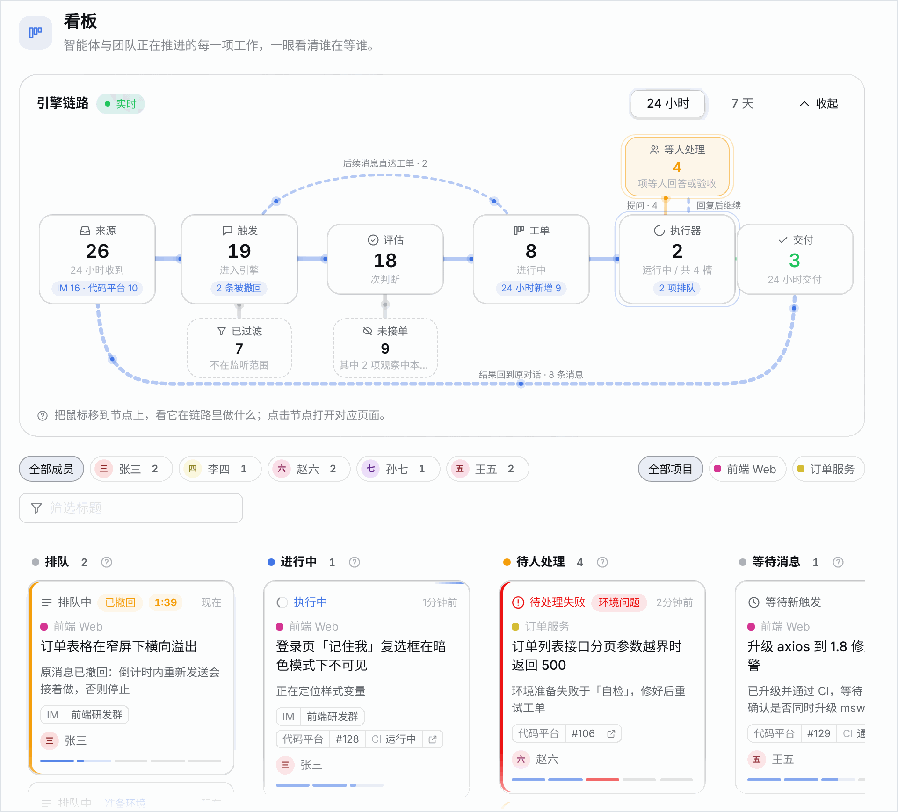

*图 8　看板。琥珀色只留给「等人处理」。*

**工单详情：一件事的全过程。** 从收到请求、接单、执行、验收到结束的步进条；消息在人、智能体、执行器、系统四条泳道之间怎么流转；以及这份工作的授权依据：谁触发的，为什么接，范围多大，按哪版策略。

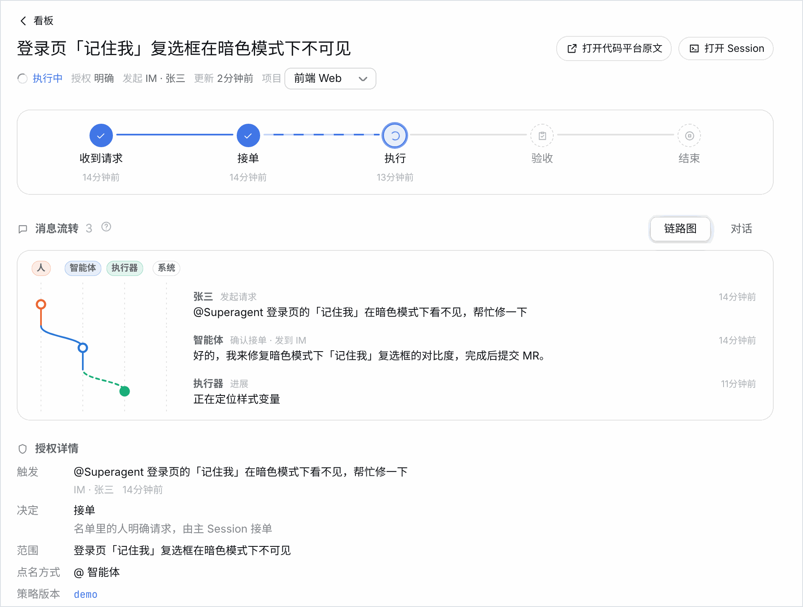

*图 9　一张工单的全过程和它的授权依据。*

**团队：提效了没有，系统自己记。** 近 14 天的新工作、已交付、交付中位时长、MR 合并率、一次交付率、每项打扰次数和主动接单数，以及工作从哪里来、以什么方式结束。我们刻意把「每项打扰」放进核心指标：Super Agent 省的是人的注意力，这个数字比写了多少行代码更说明问题。

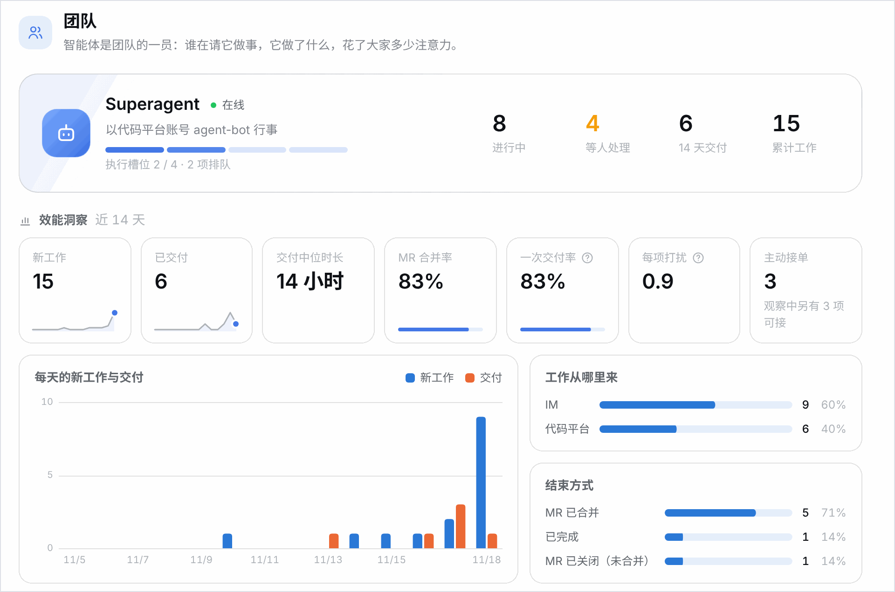

*图 10　团队页。交付时长、一次交付率、每项打扰，都由系统自动记录。*

**项目：一个实例服务多个仓库，学到的东西要人确认。** 上游原型一个部署只对一个仓库，我们加了「项目」：工单落在某个项目里，在本机那份能跑的代码上开一个独立的 worktree，按清单补齐环境（复制配置、克隆依赖、执行引导命令、自检），每个工单各占独立的端口，自检通过才开工，环境出问题的工单会单独标出来。Agent 在工作中学到的路由线索、提出的环境改动，都进入「项目记忆」，**必须有人点确认才生效，而且不授予任何权限**。

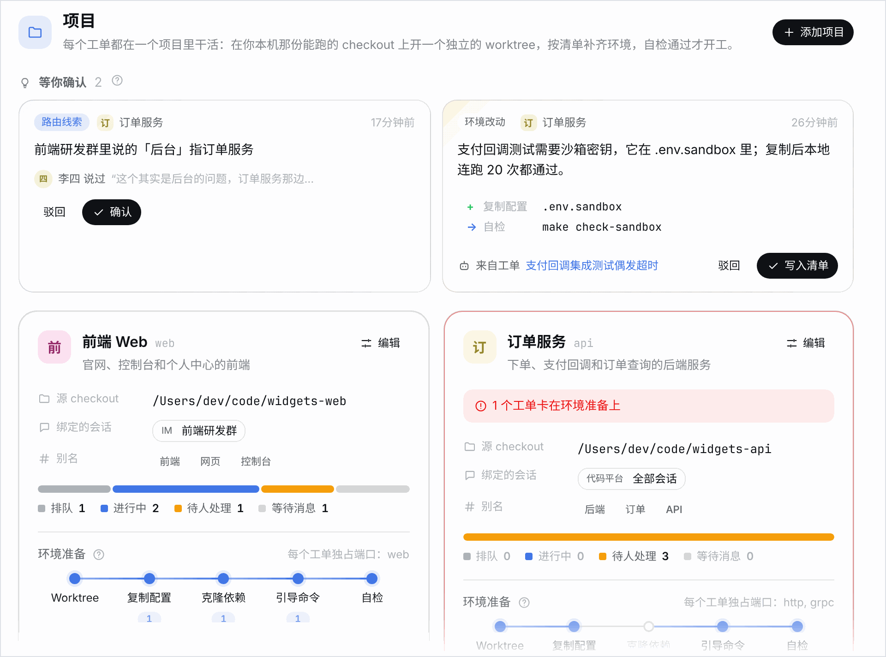

*图 11　项目页：等人确认的项目记忆，以及每个项目的环境准备情况。*

还有一个容易被忽略的小功能：**撤回消息**。有人在 IM 里撤回了一条请求，Agent 也要跟着撤回：擦掉原文，从评估里拿掉；由这条消息发起的工单先暂停两分钟，期间重新发送就接着做，否则停止。

几点体会：

1. **看得见，是信任的前提。** 团队愿不愿意把活交给 Agent，取决于能不能随时看清它在做什么、卡在谁身上。原型的状态原本都在数据库里，我们做的事情，本质上是把它变成人能直接看、直接操作的控制面。阿里云也把这一层做成了产品。
2. **度量要对准注意力。** 交付中位时长、一次交付率、每项打扰、主动接单，以及观察模式下「本可接」的记录，比代码行数更能回答「有没有提效」。
3. **边界先于能力。** 有了多个项目以后，记忆、环境改动、跨项目的路由都要人确认，而且不能顺带扩大权限。这和阿里云「企业先要边界」是同一个结论。
4. **两天能做完，前提是活说得清楚。** 每个页面先写清目标和验收标准，Agent 才能独立交付；说不清的部分，最后都回到了人身上。

也要如实说明：这是研究原型，面板跑在演示数据上。原型目前接的是飞书和 GitHub，接入其他 IM 和代码平台需要各写一个来源插件；单机运行、执行权限这些问题，离生产还有距离。

## 八、我们的思考：模型之外，落地看工程和组织

阿里云的文章结尾写了两个趋势，我们很认同，也想再补一点人这边的功课。

### 1. 答案在趋同：认准三样东西，不押注哪一家

| 需要什么 | 为什么 | DeepSeek | 阿里云 |
| --- | --- | --- | --- |
| 一个对外的入口 | 瓶颈是人的注意力 | Router | Channel |
| 互相隔离的执行单元 | 任务又长又多 | Worker | 任务会话 |
| 比会话活得久的任务 | 活要能追踪、能交接 | Ticket | Quest |

阿里云对照源码后的判断是，这不是互相借鉴，而是约束条件把解空间压窄了，就像数据库最终都走向预写日志，操作系统最终都走向进程和调度器。架构会成为标配，选型不必焦虑。产品和模型都可以换，带得走的是我们自己沉淀的工单、规则和验收标准。

### 2. Agent 正在回到传统工程

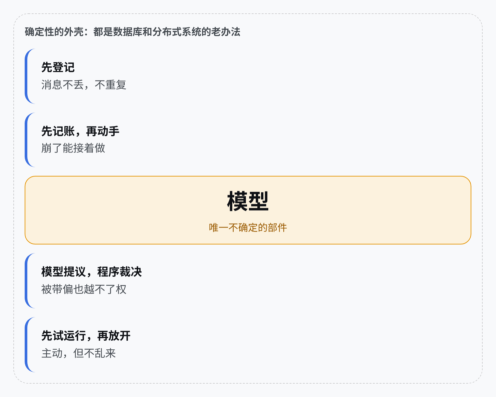

*图 12　用确定性的外壳，包住唯一不确定的部件：模型。*

当 Agent 从「一次对话」变成「长期运行的进程」，它就要面对分布式系统的老问题：进程会崩，机器会离线，消息会重复，副作用不能执行两次。所以在 DeepSeek 和阿里云的代码里，越来越多看到的是数据库和分布式系统的经典手段：先登记、预写日志、Outbox、租约、可以回放的事件记录。用阿里云的话说：**模型是 CPU，Harness 是操作系统和数据库。**

所以评估一个 Agent，别只问模型多强，还要问它出错、中断时能不能恢复。模型半年换一代，这层外壳才是团队自己的资产。

### 3. 功课在人这边：能被独立验收的活，才交得出去

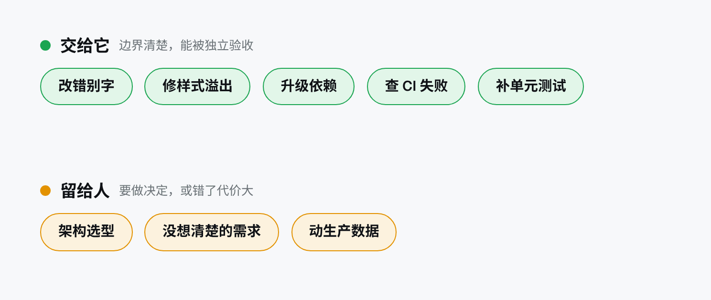

*图 13　边界清楚、能被独立验收的，交给它；要做决定，或者错了代价大的，留给人。*

Cognition 的《Don't Build Multi-Agents》和 Anthropic 的多 Agent 研究系统曾经各执一词。阿里云的理解是两边都有道理：调研可以切开，一个游戏的美术风格切不开。答案不是该不该用多 Agent，而是切分的边界在哪里：**只有能被独立验收的工作，才能分出去。**

注意力解放出来之后，新的瓶颈是把活说清楚：目标、验收标准、责任人。这件事模型替不了我们。做好了，收益有三层：对个人，整块时间不被打断；对团队，小需求有人接，多件事并行；对管理，看得见，量得出，管得住。

**如果要在团队里试一试，我们的建议是：**

1. 从观察模式开始，先看它判断得准不准，再放开自动接单；
2. 从边界清楚、能独立验收的小活开始：改文案、修样式、升级依赖、查 CI 失败、补测试；
3. 用一次交付率和每项打扰次数说话，而不是代码行数；
4. 接入自己的 IM 和代码平台需要写来源插件；执行环境和权限，从小而可信的范围起步。

DeepSeek 说，单任务的上限取决于模型能力，多任务的上限取决于人的注意力。我们想接上半句：**能不能落地，看的是工程和组织。**

## 参考资料

1. DeepSeek Harness 团队，《Super-agent 设计探索：迈向更自主的 Agent 系统》，2026-10-31。
2. DeepSeek，开源研究原型 dsh-superagent-prototype（MIT）：<https://github.com/deepseek-ai/dsh-superagent-prototype>
3. DeepSeek Harness：<https://github.com/deepseek-ai/deepseek-harness>
4. 阿里云 AgentCore，《关于 DeepSeek 的 SuperAgent，以及我们的实践》，2026-11-10：<https://mp.weixin.qq.com/s/AI3cr067LM5vw2GKvmY6kQ>；收录于 Alibaba Cloud AI Agent Handbook：<https://github.com/aliyun/ai-agent-handbook>
5. Anthropic，Employment at Anthropic，2026-10-16：<https://www.anthropic.com/research/employment-at-anthropic>
6. LangChain，Introducing Ambient Agents：<https://blog.langchain.com/introducing-ambient-agents>
7. Cognition，Don't Build Multi-Agents：<https://cognition.ai/blog/dont-build-multi-agents>
8. Anthropic，How we built our multi-agent research system：<https://www.anthropic.com/engineering/multi-agent-research-system>
9. 非官方评测 superagent-prototype-evaluation：<https://github.com/pans1es/superagent-prototype-evaluation>
10. 文中提到的产品：OpenClaw <https://github.com/openclaw/openclaw>，Multica <https://github.com/multica-ai/multica>，Claude Tag <https://www.anthropic.com/news/introducing-claude-tag>，WorkBuddy <https://www.workbuddy.cn/>，ChatGPT dots <https://techcrunch.com/2026/09/29/openai-launches-dots-its-bubbly-agentic-avatar/>

*文中截图均为演示数据，人名为占位名。产品定位和时间线是我们基于公开资料的判断，日期据厂商公告和公开报道整理。*
